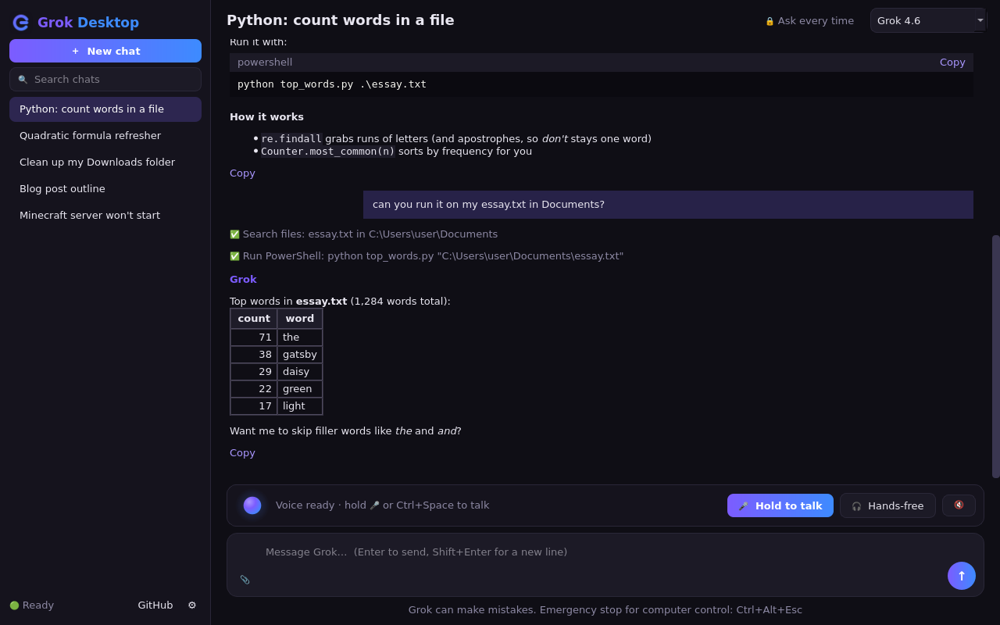

# Grok Desktop

A desktop chat app for Grok for Linux, Windows and macOS. It drives the official `grok` CLI over the
Agent Client Protocol (`grok agent stdio`), signed in with a SuperGrok account, so no xAI API key is needed.

> **Unofficial.** Grok Desktop is an independent community project. It is not made, endorsed or supported by xAI.
> "Grok" is a trademark of xAI. You need an active SuperGrok subscription and the official `grok` CLI installed and signed in.



## Features
- Chat with a history sidebar (search, rename, delete), Markdown, highlighted code blocks, streaming and Stop
- Attachments (drag and drop, paste, file picker), inline images
- Computer control through a built-in MCP server (files, shell, screenshots, mouse/keyboard, windows, apps),
  with a permission system for risky actions
- **Voice mode**: offline speech-to-text and text-to-speech (sherpa-onnx; Zipformer ASR, Piper voices) with an animated orb.
  Voice models download on first use.
- **GitHub integration**: sign in via the GitHub CLI (`gh`), clone, pull, push and create repositories from the app

## Download
Grab the latest build from the [Releases page](https://github.com/Zander11111/grok-desktop/releases/latest):

| Platform | File |
|---|---|
| Windows (64-bit) | `grok-desktop-<version>-windows-amd64.exe` (installer) |
| macOS (Apple Silicon) | `grok-desktop-<version>-macos-arm64.dmg` |
| Linux, Debian/Ubuntu | `grok-desktop-<version>-linux-amd64.deb` (`sudo apt install ./grok-desktop-*.deb`) |
| Linux, other distros | `grok-desktop-<version>-linux-amd64.tar.gz` |

`SHA256SUMS.txt` lists checksums for every file. The builds are unsigned: on Windows click "More info" then "Run anyway"
at the SmartScreen prompt; on macOS right-click the app and choose Open the first time. Intel Macs aren't built yet.

## Requirements
- Python 3.12+ and PySide6 (Qt 6)
- The `grok` CLI installed and signed in
- `gh` for GitHub features

## Run from source
```bash
python -m venv .venv && . .venv/bin/activate
pip install PySide6 markdown pygments python-xlib sherpa-onnx
PYTHONPATH=src python -m grok_desktop
```

## Build
- Linux (.deb and tar.gz): `scripts/vendor-linux.sh` then `scripts/build-linux.sh` → `dist/`
- Windows: `scripts/build-windows.ps1` (PyInstaller + Inno Setup, see `packaging/`)
- Windows and macOS release builds run automatically in GitHub Actions (`.github/workflows/release-builds.yml`) whenever a release is published
- Tests: `scripts/run-tests.sh` (uses a fake grok in `tests/fake_grok.py`)

## Contributing and security
See [CONTRIBUTING.md](CONTRIBUTING.md). Report vulnerabilities privately as described in [SECURITY.md](SECURITY.md).

## Not in the source tree
Built packages live on the Releases page rather than in git. The `dist/` and `build/` folders, the virtualenv and
downloaded voice models are also excluded.
